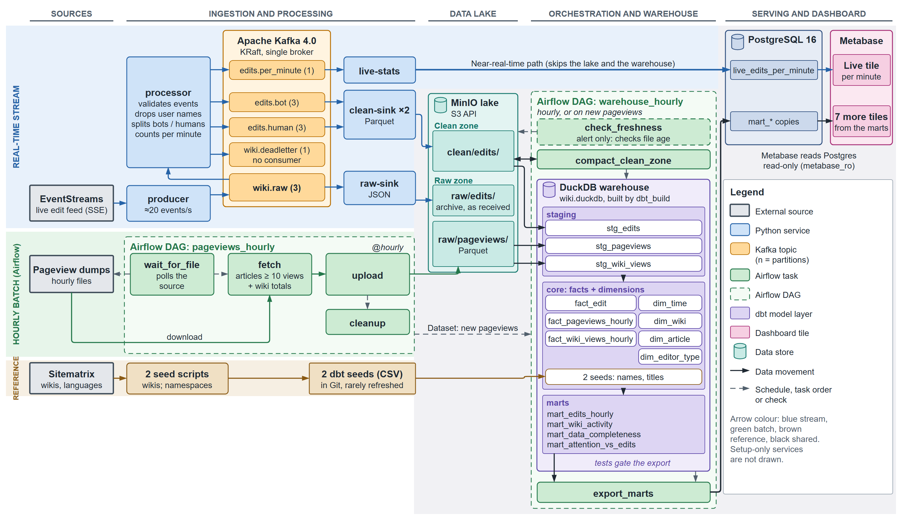

# Wikipedia live edits pipeline

[](https://github.com/lynn60107070/dsai5102-wiki-pipeline/actions/workflows/tests.yml)

DSAI5102 Data Architecture & Engineering, final project · Lynn Younes & Sumaiya Rizwan

**Report (PDF):** [report/DSAI5102_report_Younes_Rizwan.pdf](report/DSAI5102_report_Younes_Rizwan.pdf) · LaTeX source in [paper/](paper/)

**Question:** Wikipedia's volunteer patrollers have limited time: where does editing pressure
concentrate, how much of it comes from bots, and are spikes in reader attention followed by edit surges?

An end-to-end data pipeline that streams every edit on every Wikimedia wiki live through Kafka, loads
hourly pageview files in batch with Airflow, keeps both in a MinIO data lake, models them as a star
schema with dbt on DuckDB, and serves a Metabase dashboard, including a near-real-time tile.

## Quick start (one command)

Requirements: **Docker Desktop with at least 8 GB of memory** (Settings → Resources) and Git, on macOS
(Intel or Apple Silicon), Windows or Linux.

```bash
git clone https://github.com/lynn60107070/dsai5102-wiki-pipeline.git
cd dsai5102-wiki-pipeline
docker compose up -d --build
docker compose logs -f bootstrap        # optional: watch the setup; ends with "ready: ..." (~5 min)
```

No configuration is needed: every setting has a working default (`.env.example`). To change passwords,
copy `.env.example` to `.env` and edit it before the first `up`.

**What you'll see:** a fresh install has no history yet, so the one-off `bootstrap` service loads
**6 bundled hours of real data** (`sample/`: 4 Nov 06:00–12:00 UTC, about 380k edits, no user names, plus
the pageviews for those hours and the 24 before them, so the attention-spike tile has spikes to show)
into the empty lake, builds the warehouse once and sets up the dashboard. At the same time the live stream starts collecting, and
the live tile fills within minutes. The sample is only ever loaded into an empty lake.

| Open | Address | Login (defaults) |
|---|---|---|
| **Dashboard** (Metabase) | http://localhost:3000 → *Wikipedia edits* | `admin@example.com` / `change-me-Metabase-123` |
| Orchestration (Airflow) | http://localhost:8080 | `admin` / `change-me-airflow-123` |
| Data lake (MinIO) | S3 API on http://localhost:9000; no web console (see below) | `lakeadmin` / `change-me-lake-123` |

To browse the lake, use MinIO's command-line client inside its container (the last free MinIO build has
no web console): `docker compose exec minio mc ls --recursive local/lake/clean/edits/ | head`.

Add `#refresh=60` to the dashboard URL to auto-refresh the live tile.

## Architecture



Arrow colour shows the path (blue stream, green batch, brown reference, black shared); solid arrows move
data, dashed arrows are schedules or task order; numbers in brackets are Kafka partitions. Source and
exports: [docs/diagram/](docs/diagram/), explained box by box in
[architecture_explanation.md](docs/diagram/architecture_explanation.md). The same in text:

```
                       ┌──────────────────────────── stream (always on, Docker Compose services) ─────────────────────────┐
Wikimedia EventStreams ─► producer ─► [wiki.raw] ─┬─► raw-sink ──────────────────────────────► lake: raw/edits  (as received)
  (~20 edits/s kept)                              └─► processor ─┬─► [edits.bot]  ┐
                                                                 ├─► [edits.human] ┴─► clean-sink ×2 ─► lake: clean/edits (Parquet)
                                                                 ├─► [edits.per_minute] ─► live-stats ─► Postgres serving ─┐
                                                                 └─► [wiki.deadletter]                                     │
                       ┌──────────────────────────── batch (Airflow) ───────────────────────────────────────────────────┐  │
pageview dumps (hourly) ─► pageviews_hourly: wait → fetch → upload ─► lake: raw/pageviews ── Dataset ─┐                  │  │
                          warehouse_hourly (hourly + on new pageviews):                               ▼                  │  │
                            compact clean zone → dbt build (DuckDB star schema + 35 tests) → export ─► Postgres serving ─┼──┤
                                                                                                                          ▼  ▼
                                                                                              Metabase (read-only user)
```

| Layer | Tool | Job | Why this tool |
|---|---|---|---|
| Containers | Docker Compose | Starts all 14 services with one command | Reproducible on any laptop; taught in lab 5 |
| Streaming | Apache Kafka 4.0 (KRaft; Confluent image cp-kafka 8.0.0) | 5 topics, 4 consumer groups | Durable, replayable event log; taught in lab 10 |
| Stream processing | Python services | Validate, remove user names, split bot/human, per-minute counts | Simple, unit-tested; enough for ~20 events/s |
| Data lake | MinIO (S3 API) | Raw + clean zones, partitioned `dt=/hour=` | S3-compatible locally; as in the course demo |
| Orchestration | Apache Airflow 2.11 | Pageview ingestion, warehouse refresh | Taught in lab 8; Datasets for data-aware scheduling |
| Warehouse | DuckDB | Star schema, columnar analytics | Fast on a laptop, reads Parquet on S3 directly |
| Transformations | dbt | Staging → core (facts, dims) → marts, tests | Versioned, tested SQL; incremental models |
| Serving | PostgreSQL 16 | Dashboard tables, read-only user | DuckDB allows one writer, so the dashboard reads copies |
| Dashboard | Metabase | Tiles on the marts + a live tile | Free, quick, scripted setup |

Design decisions, measurements and trade-offs: **[docs/design.md](docs/design.md)**.

## Services

| Service | What it does |
|---|---|
| `broker`, `kafka-init` | Kafka (single broker, KRaft); `kafka-init` creates the topics, then exits |
| `producer` | Reads Wikimedia EventStreams, keeps edits + new pages, writes to `wiki.raw` keyed by wiki; resumes from its last event after a restart |
| `raw-sink` | `wiki.raw` → `s3://lake/raw/edits/dt=/hour=/` (gzipped JSON lines, exactly as received) |
| `processor` | `wiki.raw` → validates, removes user names, splits into `edits.bot` / `edits.human`, counts edits per minute (`edits.per_minute`); failures → `wiki.deadletter` |
| `clean-sink` (×2) | Consumer group on `edits.bot` + `edits.human` → Parquet in `s3://lake/clean/edits/dt=/hour=/`. Scale: `docker compose up -d --scale clean-sink=3` |
| `live-stats` | `edits.per_minute` → Postgres `serving.live_edits_per_minute` (the live tile) |
| `minio` | Data lake (S3 API on `:9000`; browse with `mc`, see Quick start) |
| `postgres` | Databases `airflow` (metadata), `serving` (dashboard tables), `metabase` (Metabase settings). Host port `5433` |
| `airflow-init`, `airflow-webserver`, `airflow-scheduler` | Airflow (LocalExecutor). The image also contains dbt + DuckDB |
| `metabase` | Dashboard; reads `serving` as the read-only user `metabase_ro` |
| `bootstrap` | One-off setup at the end of every `up`: sample data (empty lake only), first warehouse run, Metabase setup |

**DAGs:** `warehouse_hourly` (on by default) and `pageviews_hourly` (paused on a fresh install: once
unpaused in the Airflow UI it backfills every hour since 25 Oct, ~57 MB download per hour). The sample
includes 30 hours of pageviews, so every tile has data on a fresh install. If the lake has no pageview
files at all, `warehouse_hourly` builds without the pageview models, so the edit tiles still work.
Unpausing it means about 740 hours and 42 GB of downloads (several hours, and each upload queues a
warehouse run). To try the batch path, leave it paused and run one recent hour (yesterday, within the
warehouse's 3-day lookback) end to end:

```bash
docker compose exec airflow-scheduler airflow dags test pageviews_hourly "$(date -u -d '-1 day' +%Y-%m-%dT%H:00:00+00:00)"
```

This runs wait_for_file, fetch, upload and cleanup for that hour (about a minute) and then triggers
`warehouse_hourly`. The warehouse loads only the last 3 days incrementally, so after loading hours older
than that, rebuild once with a longer lookback:
`docker compose exec airflow-scheduler bash -c 'cd $DBT_PROJECT_DIR && dbt build --vars "{lookback_days: 30}"'`. On a fresh install the hourly tiles show the 6 sample hours (4 Nov) and then the live hours,
with an empty stretch between them; that is expected.

## Repository layout

```
docker-compose.yml   all services          stream/     producer, processor, sinks, status (Python)
airflow/             DAGs + image (dbt)     ingest/     pageviews (batch), wiki names + namespaces (seeds)
dbt/                 models, seeds, tests   scripts/    bootstrap, export, compaction, Metabase setup, checks
postgres/init/       databases + roles      sample/     6 hours of real data for a fresh install
tests/               unit tests             docs/       design log + diagram       paper/   report source (LaTeX); the PDF is in report/
analysis/            the queries behind the report's findings (run against Postgres `serving`; they need the
                     collected 28 Oct–11 Nov window, which is not in the repo; on a fresh install they run on the sample)
```

## Operating it

| Task | Command |
|---|---|
| Collector status (events per hour, gaps) | `docker compose exec raw-sink python -m stream.status` |
| Follow a service | `docker compose logs -f processor` |
| Rebuild the warehouse now | trigger `warehouse_hourly` in the Airflow UI |
| Stop (data is kept) | `docker compose down` |
| Stop and delete all data | `docker compose down -v` |

Running a warehouse step by hand (not while `warehouse_hourly` is running: DuckDB allows one writer):
```bash
docker compose exec airflow-scheduler bash -c 'cd $DBT_PROJECT_DIR && /opt/airflow/dbt-venv/bin/dbt build'
docker compose exec airflow-scheduler /opt/airflow/dbt-venv/bin/python /opt/airflow/project/scripts/export_marts.py
```

## Troubleshooting

| Problem | Fix |
|---|---|
| A port is already in use (5433, 8080, 3000, 9000, 9092) | Stop whatever uses it, or change the left side of that service's `ports:` in `docker-compose.yml` |
| Containers restart or Docker is very slow | Give Docker Desktop at least 8 GB of memory; the stack uses about 4.5 GB |
| `bootstrap` exited with an error | `docker compose logs bootstrap`, then `docker compose up -d` to run it again (it is safe to re-run) |
| Git Bash on Windows rewrites `/opt/...` paths | Run `export MSYS_NO_PATHCONV=1` first |
| Live tile is empty | Normal for the first ~3 minutes after the stream starts |
| Windows: Docker's disk file (`%LOCALAPPDATA%\Docker\wsl\disk\docker_data.vhdx`) is much bigger than `docker system df` | It never shrinks by itself. Trim, then compact it: (1) `docker run --rm --privileged --pid=host alpine nsenter -t 1 -m -- fstrim -av`; (2) quit Docker Desktop, then `wsl --shutdown`; (3) in an **Administrator** PowerShell: `diskpart`, then `select vdisk file="<path above>"`, `attach vdisk readonly`, `compact vdisk`, `detach vdisk`, `exit`; (4) start Docker Desktop. The stream replays what it missed. (On 27 Oct this took the file from 424.7 GB to 31.6 GB.) |

## Tests

```bash
python -m venv .venv && source .venv/bin/activate      # Windows: .venv\Scripts\activate
pip install -r requirements.txt
python -m unittest -v                                  # 43 unit tests, no Docker needed
```
GitHub Actions runs the same tests, and checks that `docker-compose.yml` is valid without a `.env`, on
every push ([.github/workflows/tests.yml](.github/workflows/tests.yml)).
Data tests (35) run inside every `dbt build`.

## Data sources

- Wikimedia EventStreams `recentchange`: https://stream.wikimedia.org
- Wikipedia pageview dumps: https://dumps.wikimedia.org/other/pageviews/
- Wikimedia sitematrix API (wiki and language names) and each Wikipedia's siteinfo API (namespaces, main page)

Licences for each source are confirmed and cited in the report. Team workflow: [CONTRIBUTING.md](CONTRIBUTING.md).
